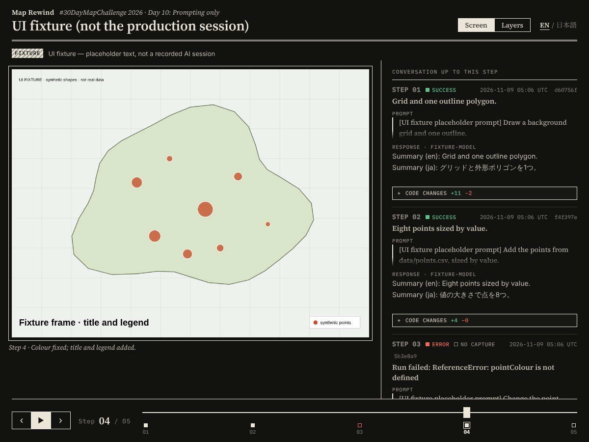
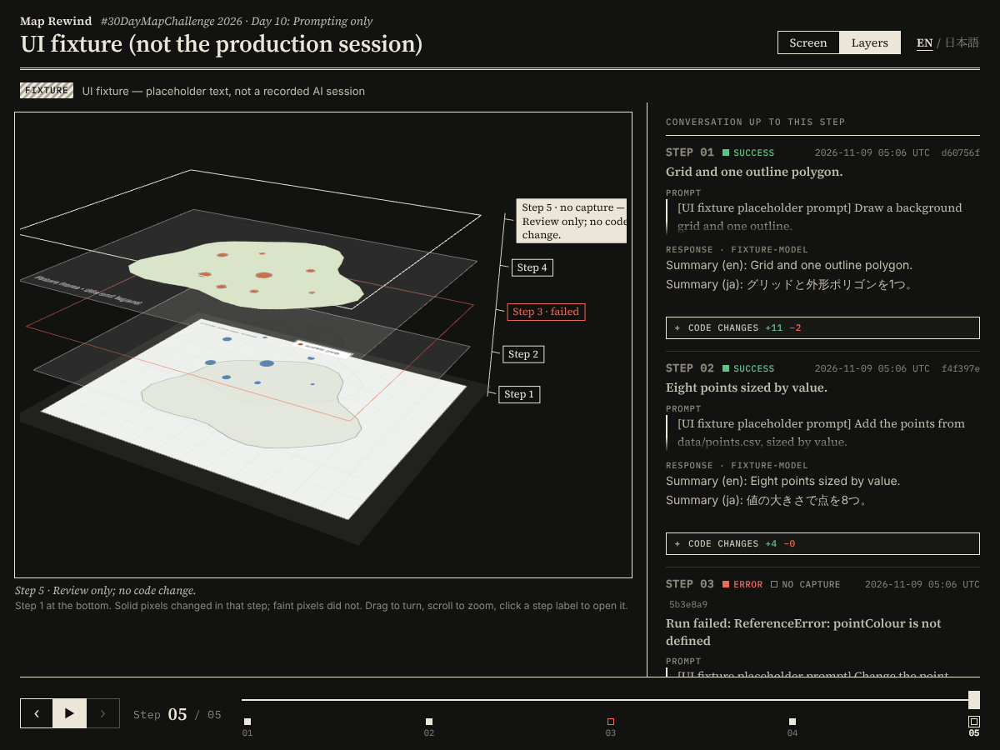

# Map Rewind — 30DayMapChallenge 2026 Day 10「Prompting only」

AIとの対話だけで地図を作り、その過程を工程ごとの画面・プロンプト・応答・コードの差分で再生する作品です。失敗した工程も含めて振り返れます。

Make a map only by talking to an AI, then replay it step by step: the screen, prompt, response and code change at each step, failed attempts included.

| 画面 | 積層 |
| --- | --- |
|  |  |

- 再生：<https://shinyanakashima.github.io/30daymapchallenge-2026day10-agent-journal/>
- 制作モード：<https://shinyanakashima.github.io/30daymapchallenge-2026day10-agent-journal/?mode=record>（OpenAI APIキーが必要。`record.html` からも移動します）

公開する作品では、制作モードの代わりに制作の様子を収めた動画を載せます（再生画面の下）。

## 現在の状態

- 再生と制作は1つの画面です。`?mode=record` を付けると、会話欄の下に入力欄が現れ、ヘッダーの「制作パネル」からキー・データ・書き出しを操作できます。制作中も、タイムラインと積層表示は記録（ブラウザ内のGit）をその場で読みます。
- OpenAI API、ブラウザ内Git、ブラウザ内でのZarr作成、ブラウザ検証は実装済みです。
- 掲載中の記録は **UI確認用fixture** です。制作モードでOpenAI APIの代わりに仮の応答を返して作りました。画面はそのコードを実際に描画したものですが、会話はAIとの実際の記録ではありません。画面上にもその旨を表示しています。
- 地図の題材・使用データ・本番の制作会話は **未決定** です。

## 全体の流れ

```
制作モード（index.html?mode=record）                再生（index.html）
  プロンプト → OpenAI → 応答とコード
           → 隔離した枠でコードを実行 → SVG → 1200×900 PNG
           → 1工程 = 1コミット（ブラウザ内のGit、main のみ）
  「Zarrを作成」→ session.json + frames.zarr + thumbs.zarr  →  public/sessions/<id>/ に置いて公開
```

サーバーは使いません。Git・描画・Zarrの作成はすべて閲覧中のブラウザの中で行い、IndexedDBに保存します。

## 制作モード

| 機能 | 内容 |
| --- | --- |
| 対話 | 会話欄の下の入力欄からプロンプトを送る。応答待ち・実行中は会話欄に表示し、終わると新しい工程として画面・タイムライン・積層に加わる |
| 制作パネル | ヘッダーのボタンで開く。以下の操作をまとめている |
| 記録 | 新規作成、リポジトリの書き出し／読み込み（.zip）、削除 |
| モデル | OpenAI APIキーを保存し、モデル一覧から選ぶ |
| データ | データファイルを `data/` に追加し、出典・ライセンス・URLを記入する |
| 手動の工程 | APIを使わずに、プロンプト・応答・画面（SVGまたはPNG）・コードを記録する |
| 書き出し | Gitの履歴から再生用のファイルを作り、ローカルでプレビューしてから .zip でダウンロードする |

### OpenAI APIキー

- キーはこのブラウザの localStorage にだけ保存し、`api.openai.com` にだけ送ります。記録（Git）、書き出したファイル、再生ページには入りません。「キーを消去」で削除できます。
- 利用料はキーの持ち主のOpenAIアカウントに請求されます。
- 使うのは Chat Completions API です。モデル名は応答に含まれるものを工程ごとに記録し、再生ページの「モデル」に表示します。

### モデルに送る内容

毎回の依頼には次を含めます。記録には、利用者が入力したプロンプトとモデルの応答をそのまま残します。

1. `prompts/system.md` の指示（記録の作成時にコミットされる）
2. それまでの対話（以前の応答に含まれるコードは省略し、今のコードを別に送る）
3. 今の `map/main.js` と、データファイルの概要（行の見本、GeoJSONの地物数と属性名）

### 地図コードの実行と撮影

- モデルは `map/main.js` を丸ごと書き換えます。コードは D3 v7 で 1200×900 のSVGに描きます。
- コードは `sandbox="allow-scripts"` の iframe で実行し、通信を禁止するCSPを付けています。localStorage（APIキー）、cookie、親ページ、ネットワークには届きません（検証済み）。
- 描かれたSVGを画像にして撮影します。描画に失敗した工程は、エラーを「ツール出力」として残し、画面なし（失敗）の工程になります。
- 各工程のコミットには、プロンプト、応答、コードの変更、画面のSVG（`screen.svg`）とPNG（`capture.png`）が入ります。

### Git

ブラウザの中で [isomorphic-git](https://isomorphic-git.org/) を使い、`main` だけを管理します。差分の管理に専用の仕組みを作らず、普通のGitリポジトリにしています。書き出した .zip を展開すると、そのまま `git log` や `git show` で読めます（`git fsck --strict` で確認済み）。

```
journal.json            題名、種類、記録方法、データの出典
prompts/system.md       モデルへの指示
map/main.js             地図のコード
data/…                  データファイル
steps/s01/step.json     状態、要約、時刻、メッセージの一覧、モデル名
steps/s01/01-user.md    プロンプト
steps/s01/02-assistant.md
steps/s01/03-tool.md    実行エラー（失敗した工程のみ）
steps/s01/screen.svg    描画されたSVG
steps/s01/capture.png   1200×900 の画面
```

## 再生

| 位置 | 内容 |
| --- | --- |
| メイン | 選択した工程の画面（`画面`）、または工程を層として積んだ立体（`積層`） |
| サイド | その工程までのプロンプト・応答・ツール出力、変更内容、コードの差分 |
| 下部 | 工程番号、前／次、再生／停止、ドラッグできるタイムライン |
| 画面下 | 記録方法、データ出典、モデル |

- 英語で表示し、日本語に切り替えられます（`?lang=ja`）。
- キーボード：← → で工程移動、Home／End、Space で再生／停止、`C` で画面／積層の切り替え。
- `?step=<stepId>`、`?session=<id>`、`?view=layers`、`?mode=record`。`?session=local` は制作パネルで作ったローカルプレビューです。
- `public/sessions/index.json` の `video` に `{ "src": "media/….mp4", "poster": "…", "caption": { "en": "…", "ja": "…" } }` を書くと、画面の下に動画を表示します。動画ファイルは `public/media/` に置きます。
- 画像の状態を区別します：読み込み中／表示中／失敗した工程（画像なし）／画像のない工程／取得・復号の失敗（再試行ボタン付き）。失敗した工程に他の工程の画像を表示しません。
- 応答の中のコードは折りたたみ、実際の変更は「コードの変更」に差分で表示します。

### 積層

工程ごとの画面を水平な層として、工程1を一番下に積み上げます（Day 8「空き家」の国勢調査年の層と同じ見せ方）。各層では、前に撮影した工程から変わった画素を濃く、変わっていない画素を薄く描きます。失敗した工程は赤い枠、画像のない工程は枠だけの層です。three.js（0.186.1）と縮小配列は、積層表示を開いたときにだけ読み込みます。

## Zarrの役割と限界

| 項目 | 内容 |
| --- | --- |
| 形式 | Zarr v3、`uint8`、次元 `(step, y, x, channel)`、RGBA |
| frames.zarr | shape `(N, 900, 1200, 4)`、chunks `(1, 900, 1200, 4)` |
| thumbs.zarr | shape `(N, 450, 600, 4)`、chunks `(1, 450, 600, 4)`、2×2画素の平均 |
| codec | `bytes` → `gzip(level=6)` |
| 作成 | 制作モード（fast-png でPNGを復号、fflate でgzip） |
| 読み込み | zarrita 0.7.5 の `FetchStore` で、選択した工程のチャンクだけを取得・復号する |

役割：画面の並びを工程番号で索引し、1枚ずつ取り出すための配列です。積層表示では工程の軸をそのまま高さにしています。

限界：

- PNGより小さくなるとは限りません。fixtureの3枚では、gzipチャンクの合計が 161,874 B、制作モードが書いたPNGが 171,226 B でした。以前、Playwrightで撮ったPNG（より強く圧縮されたもの）と比べたときは、gzipの方が約1.2〜1.3倍大きくなりました。本番の画像で測り直します。
- 画面ピクセルの配列で、地理参照付きラスタではありません。CRSや座標は持たせていません。会話とコードの差分は `session.json` に入れ、Zarrには入れていません。
- zarrita は欠けたチャンクを既定で透明な黒として返すため、このアプリでは欠けたチャンクをエラーとして扱います。
- 積層の層は縮小配列から作るため、細い線や文字は粗くなります。「変わった画素」は、前の画面とのRGBの差の合計が24を超えた画素です。地図の範囲を動かすと画面全体が「変わった」扱いになります。
- 撮影は閲覧者のブラウザでSVGを画像にしたものです。フォントは端末のシステムフォントになるため、別の端末で同じコードを描くと画素は一致しません。記録に残るのは、制作に使った端末で撮った画面です。

## 再現方法

```sh
npm ci
npm run dev          # http://localhost:5173/ と /?mode=record
npm run build        # dist/（GitHub Pages 用、相対パス）
```

検証（Playwright と Chromium が必要。Pythonは任意）：

```sh
npm run build
npm run verify                         # 再生ページ：docs/verification.json
node scripts/verify-recorder.mjs --python .venv/bin/python
                                       # 制作モード：docs/verification-recorder.json
node scripts/verify-recorder.mjs --write-fixture   # fixture を制作モードで作り直す
npm run screenshot                     # docs/screenshot.png（1200×900）
VIEW=layers OUT=docs/screenshot-layers.png npm run screenshot -- s05
```

`--python` には zarr と Pillow の入ったPythonを渡します（`pip install -r tools/requirements.txt`）。ブラウザで作ったZarrをzarr-pythonで読み、PNGをPillowで復号して、ブラウザと同じRGBAになることを確かめます。

`tools/` には、制作モードを使わずに作る場合の道具を残しています（`capture.mjs`：Playwrightで1200×900を撮影、`build_session.py`：PNGと記録JSONからZarrを作る）。

## 検証結果

- 再生 `docs/verification.json`：31項目すべて合格。最初・中間・最後の画像のRGBA hash一致、工程と会話と画像の対応、高速操作で古い画像が上書きしないこと、工程ごとに必要なチャンクだけを取得すること、壊れた／欠けたチャンクのエラー表示、キーボード、日本語、モバイル、積層表示。
- 制作モード `docs/verification-recorder.json`：19項目すべて合格（OpenAI APIは仮の応答に置き換え）。5つのプロンプトから5工程のコミット、制作中のタイムラインと積層表示が記録をその場で反映、失敗した実行はエラーを残して画面なし、APIキーはAuthorizationヘッダーにだけ入る、ブラウザで作ったZarrをzarr-pythonが読めてhashが一致、PillowとブラウザのPNG復号が一致、書き出したリポジトリが `git fsck --strict` を通る、ローカルプレビュー、再読み込み後の保持、別のブラウザへの読み込み、隔離した枠からキー・cookie・通信・親ページに届かないこと。

確認はChromium（Playwright同梱版）で行いました。他のブラウザでは未検証です。

## ファイル構成

```
index.html, src/main.ts     再生と制作の画面
src/frames.ts               Zarr読み込み、キャッシュ、先読み、中断
src/stack.ts                積層表示（three.js）
src/record/mode.ts          制作モード（入力欄、制作パネル）
src/record/                 制作に使う部品
  git.ts                    ブラウザ内Git（isomorphic-git + LightningFS）
  llm.ts                    OpenAI Chat Completions、指示文
  sandbox.ts                地図コードの隔離実行とSVGの画像化
  build.ts, zarr-write.ts   Gitの履歴 → session.json + Zarr
fixtures/ui-fixture/        fixtureの仮の応答、データ、書き出したリポジトリ（journal.zip）
public/sessions/            公開する記録
scripts/                    検証、画面画像
tools/                      制作モードを使わない場合の道具
```

## ライセンス

コードは MIT（[LICENSE](LICENSE)）。本番で使うデータは、それぞれの提供元のライセンスに従います。
